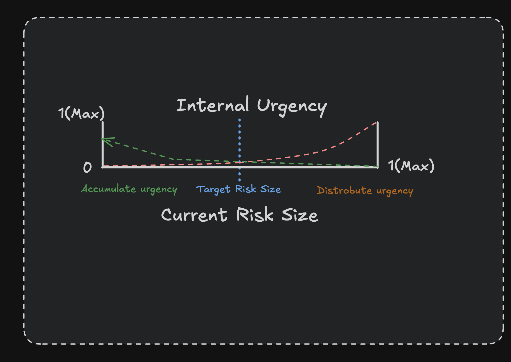

# Opposite Bid Trend

Status: in progress

Working name: Opposite Bid Trend (formerly Candle Inventory)

Updated: 2026-11-24

## Next session

Start with **how much to add or take off on a qualifying candle**. Commit `7258a969` in mm_v04 implements the selected direction-only approach. Set `params.signal_feature = "emac_10_200"` on `opposite_bid_trend`. Example supplies the direction and Opposite Bid owns the position. All 2,308 processed scores matched the saved BTC daily Example reference, and 37 focused offline checks passed at closeout. A historical Opposite Bid performance result for this EMA signal is still pending.

Pick a target risk size between flat and the exposure cap. On a qualifying candle, compare current risk size with that target to decide how quickly to accumulate or distribute. Additions currently use a fraction of the cap and distributions use a fraction of the inventory held. Preserve those units when sketching the curves. At flat there is nothing to distribute, at the cap there is no room to add, and a zero or opposing signal still calls for a full exit. The target level and the curve shapes are open.

Destin originally used internal urgency to decide when to cross the spread. Here the same intuition can pace order size. Candle streaks could help estimate how many qualifying candles remain, while the market-making model could price the value of one more unit. Both are ideas for later. For the first replay, the current fixed fractions give a reference for seeing when urgency changes inventory and how much open profit is subsequently booked or given back.

## Core idea

> Get me on the right side of the trend and let execution handle the rest.

The trend signal chooses direction. Execution manages when and how much inventory to accumulate or distribute. “Opposite bid” means accumulating against the immediate candle move while staying aligned with the broader trend: buy red candles in a positive trend, and mirror this for shorts. It does not currently imply passive limit orders; the prototype uses simulated market fills.

## Main dials

- **Trend signal.** Use `params.signal_feature` to run one feature through the inventory policy. Custom ADX (`signed_strength × agreement`, then shared processing) is the default. The static example uses `params.signal` directly to isolate execution. The eventual blend, including its components and weights, remains open.
- **Execution:** entry timing, accumulation size, distribution size, and exposure control. A constant accumulation fraction (default 10% of the cap) and distribution fraction (default 100% of current inventory in the ADX variant) are starting points. The static example retains full profit exits. The aim is to make accumulation and distribution adaptive.
- **Required profit after costs:** the reward demanded before distributing inventory. The additional buffer currently defaults to 10 BPS. It will likely become adaptive to asset volatility and risk: how much reward is needed to compensate for the risk taken? The risk measure, horizon, and mapping to required BPS remain undecided.

## Active research — 2026-11-24

The working focus is a prospective trend signal, accumulation and distribution fractions, and position sizing. The static example remains useful for isolating execution. A blend of trend features is the likely direction. The components, weights, and neutral band are open research choices.

Use saved ADX run `d7cfc05b-32d8-44d8-93b4-08a7ac9e0723` as a reference. It scored 1,200 hourly Binance HYPEUSDT candles from 2026-10-01 to 2026-11-20 exclusive (UTC) and was profitable after simulated costs. The saved request used ADX length 50 and SMA smoothing 50, a 0.20 signal clip buffer, 10% of the cap per qualifying add, 50% of remaining inventory per profit-take, and equity-compounding sizing with a 40% Centered volatility target. Fee and slippage were 5 bps each. The saved signal repeatedly entered the neutral band, where the strategy targets flat. Future signal comparisons should measure neutral-triggered exits and turnover alongside net returns and drawdown.

The combined signal is the unit of interest. Destin reported weak results from several solo features and chose to skip the solo-feature test sequence. The selector remains available for diagnostics. Its current choices are `adx`, `emac_10_200`, `vfti`, `slope`, `rsi`, and `px`. Combo v1 and Opposite Bid Trend share the raw calculations and defaults. Destin listed `emac_10_200`, `px_ema_200`, `px_ema_10_smooth_3`, `slope_ema_200`, `multi_speed_emac`, `log_ret_blend_3_9`, `ROC`, `MACD_12_26_9`, `MACD_10_200_50`, and `DPO` as future feature candidates.

Destin chose the existing BTC daily Example forecast as the starting point for execution work. The longer-term trend blend is deferred. Earlier saved BTC daily candidates from [[engineering/bounded-ema-history]] include Example equity `0aaac038-6670-4873-b77d-d8cd131776cd` (reproduced original `481bce23-80b5-4a80-a954-438521bbcaea`) and Carver multi-speed EWMAC `fb9d9729-5f4e-4f82-9d9e-7315fc254b9a`. The first scored UTC dates were 2020-07-11 and 2020-07-14 respectively, both ending exclusive 2026-11-04.

### Example execution baseline — 2026-11-24

Saved BTCUSDT daily Example run `51d606b5-a69e-4d76-be8b-fe7b1aa204ef` uses close EMA 10/200, signed-magnitude min-max over 252 bars, scalar 1, direct sizing, and a 100% allocation at 1× leverage. It scored 2,308 bars from 2020-07-11 through 2026-11-05 exclusive with $100,000 initial capital, equity compounding, daily sizing refresh, zero deadband, volatility targeting off, and 5 bps each for fees and slippage. The processed forecast maps directly to a signed fraction of the daily base quantity. This is the reference for comparing Opposite Bid execution.

Destin flagged a possible absolute-scale sizing issue. In nearby absolute run `e34875c9-5263-4838-be4b-063dd8dc256e`, the saved forecast exceeded the 0.5 scalar in magnitude on 1,051 of 2,308 bars. With volatility targeting off, the allocation cap can map distinct forecasts to the same maximum units. This explains saturation under that configuration. A specific erroneous fill remains unverified.

### Volatility-targeted Example comparison

Destin reports that enabling volatility targeting resolved the absolute-scaler behavior he observed. Further sizing work is deferred. BTC daily Example run `95181dd0-3944-433d-9559-00f42d114edc` used absolute scalar 0.5, a 50% annual risk target with Centered 35/200 volatility blended 70/30, a 10% rebalance buffer, and daily sizing refresh. It used the same scored dates, capital and costs as the min-max baseline. Destin calibrated the risk target against the original Example drawdown on this history. The new run delivered higher net return and Sharpe with a shallower close-to-close drawdown than the original absolute Example. Its OHLC drawdown bound approached 59%. The min-max run above remains the recorded execution baseline.

The same Example settings also produced a profitable BTCUSDT four-hour backtest. The paired run IDs, dates, and interpretation are in [[research/trading/emac-cross-10-200/emac-cross-10-200#BTC daily and four-hour Example with volatility targeting|plain EMA 10/200 research]].

### Direction-only execution — selected

Destin selected option A, reusing the sign of the daily EMA 10/200 forecast, with Opposite Bid deciding when to accumulate and distribute. The alternative would carry forward Example’s forecast-to-position sizing. For intuition, run `95181dd0-3944-433d-9559-00f42d114edc` supplies a common forecast and an execution reference. Positive forecasts preceded a stronger average next-day BTC return than negative forecasts over this window. On December 18, 2024 the forecast stayed long and the account booked profit while marked equity fell. Read time in profit among active closes, the open P&L series, and candle-to-candle equity changes together. A capture-ratio denominator and the sizing rule for a direction-only replay are still open.

The working strategy accepts `params.signal_feature = "emac_10_200"`. On the saved candle history, the processed scores matched all 2,308 BTC daily scores from Example run `95181dd0-3944-433d-9559-00f42d114edc` with its signal configuration. The December snapshot displays Example fills. The Opposite Bid feature routes the sign through the existing candle rules and fixed fractions.

Destin proposed consecutive candle duration as an input to accumulation and distribution, bounded urgency based on distance to target inventory, and a possible inventory skew from market-making quotes. The target, response to streak length, and specific quoting function remain open. One candidate is the utilization-based skew in [HFT Stack](../../../../raw/research/concepts/hft-stack.md). For a market-order strategy, its potential use is to influence trade size or eligibility. No quote-placement rule has been selected.

### Internal urgency

Destin’s sketch places the target risk size inside the range from flat to the cap. Below target, accumulation has higher urgency. Near target both curves are low and close together. Above target, distribution urgency rises steeply as the position approaches the cap. The drawing leaves the target level and curve parameters open. Destin confirmed Guéant, Lehalle and Fernandez-Tapia’s [inventory-risk paper](https://arxiv.org/abs/1105.3115) as a related source for valuing another unit of inventory.

### Latest ADX references

- HYPE run `f0cae01c-2174-4c06-b0e1-5bef1b287ba5`.
- ETH run `83935537-3c52-4739-930a-ec000fb367f6`.
- BTC run `32ad0ecf-7d82-4624-b984-5426f1de9817`.

All three scored 1,200 hourly Binance candles from 2026-10-01 to 2026-11-20 exclusive (UTC). They used equity compounding with weekly sizing snapshots (`604800` seconds), disabled volatility targeting, 10% adds, full distributions, a 10 bps profit buffer, and 5 bps each for fees and slippage. ADX used length 50 and RMA smoothing of 14 for HYPE and 50 for BTC and ETH. All three were profitable after simulated costs. HYPE led on net return and Sharpe (3.00), ETH had the deepest close-to-close drawdown (8.86%), and BTC had the lowest net return. The differing HYPE ADX settings and the other changes relative to the earlier HYPE reference prevent isolating the effect of the weekly sizing refresh.

### BTC and ETH short references

- BTC run `0fe377cd-7ed1-4ab5-ab77-0d76cb4313ba`.
- ETH run `6bdcbe48-c8e8-4b49-a44a-c9a4b234f78c`.

Both saved runs scored 480 hourly Binance candles from 2026-10-31 to 2026-11-20 exclusive (UTC) and were profitable after simulated costs. Their ADX signals were negative or zero throughout. They used ADX length 100 and RMA smoothing 100, no signal scaling, a 0.10 clip buffer, a 20 bps profit buffer, 20% accumulation, and compounding equity with a 40% Centered volatility target. Both paid 5 bps each in fees and modeled slippage. The saved requests omit the distribution fraction. Both recorded annualized Sharpes above 10 with close-to-close drawdowns around 1.5–1.6% over the same 20-day short/flat window. Read those values in the context of the shared window and regime.

## Starting policy and assumptions

The intended policy accumulates on candles opposite the signal, distributes on aligned candles when the profit floor is exceeded, and flattens on a zero or opposing signal even at a loss. A zero signal means zero target exposure, regardless of candle direction or profit threshold; already-flat inventory stays flat. Dojis with an aligned directional signal can take available profit; otherwise they hold. New-side accumulation follows on a later qualifying candle.

### Sizing

Choose the sizing refresh cadence relative to the decision timeframe and record it alongside results. A snapshot holds base and maximum units until the first candle-close decision in the next elapsed interval. `null` recalculates on every close. Daily candles allow one sizing refresh per day at most. A strategy that refreshes sizing more often needs a shorter decision interval, which can consume a daily trend signal.

Options:
1) Let fractions use % of Capital.
2) Use Sig-to-Position Sizing for target, then Fraction of Target.

Fractions:
1) Pyramidding fractions
2) Dynamic Fractions

*Idea*
Measure frequency of consective candle duration to estimate how number of fractions needed for adverse price.

## Static short example observation — 2026-11-19

Saved run `308fe3bf-a28d-4f57-9dda-d7eae1324819` ran `opposite_bid_trend_example` on 50 BTC daily candles with a constant `params.signal = -1`. Destin deliberately selected the recent 50-day window knowing the market had been down and described the performance as outstanding. The saved run confirms a successful, profitable result after simulated costs. It used 1× leverage, equity-compounding sizing, 10% fixed-fraction additions, full profit exits, a 10 BPS additional profit buffer, and 5 BPS each for fees and slippage; volatility targeting/adjustment were disabled. Detailed metrics remain in the saved run/backtest UI.

This supports the strategy's central premise in the selected regime: **get the direction right and let execution handle the rest.** A constant correct-side signal allowed the execution rules to manage accumulation and profit-taking without further signal timing. Because the direction and window were chosen with hindsight, this is an encouraging demonstration of execution conditional on correct direction; identifying that direction prospectively remains the open signal-design problem.

## Implementation status

Packaging checkpoint — 2026-11-23: Fractional distribution is committed in mm_v04
as `da3b5e28`. Updated the stale feature assertions to validate both ADX and historical
volatility outputs; all 156 tests across the two Opposite Bid Trend test modules now
pass, with scoped Ruff passing. Strategy behavior was preserved during packaging.
The snapshot MCP is committed separately as `6943c2ce` and verified through the
refreshed connection. Earlier uncommitted/excluded-test notes below describe their
original verification dates. Nothing pushed.

On 2026-11-20, added ADX Params.distribution_fraction beside accumulation_fraction, finite and in (0, 1], default 1.0. Profit-taking targets current_size × (1 − distribution_fraction), so each qualifying candle closes that fraction of remaining inventory; 0.25 closes 25%. Zero/opposing signals still flatten fully. Final caps, precision, and minimum-notional validation remain in force, so actual fills can differ from the requested fraction. The static example is unchanged. Verification: 167 focused offline checks pass, including repeated long/short partial distributions, the profit gate, full signal exits, and invalid fraction rejection; scoped Ruff/mypy pass. Eight existing ADX feature-count cases were excluded, as they expect one output while the strategy now emits two. Uncommitted.

On 2026-11-20, Destin approved zero signal → zero target exposure. The shared execution helper now returns a signal-exit event for existing inventory on zero, applying to both variants. This supersedes the previous neutral hold/profit rule; directional dojis retain the strict profit gate. Validation: 136 execution-focused offline checks plus scoped Ruff/mypy, including losing long/short exits in both variants, remaining flat on subsequent zero signals, and synthetic engine replay. A broader test attempt had eight ADX feature-count failures during concurrent feature edits; that work was left untouched. Existing order precision/minimum-notional constraints still apply.

Both the static example and ADX execution paths were repaired on 2026-11-19. Their helper decision now always supplies the inventory target, followed by the exposure cap and target-minus-current order. Fixed-fraction additions, profit-gated full exits, zero/opposing-signal flattening, directional-doji holds/profit-taking, and cap reductions on holds are covered through actual broker fills. Signal magnitude does not scale the fixed fraction; sign selects direction. Capital/risk sizing and sizing snapshots remain available. A missing finite cap is rejected explicitly for accumulation because a fraction of an unbounded maximum is undefined.

The diagnosis compared commits cca6f11a (trade events), e10f789c (fixed BPS floor), and 44f2b666 (hold caps/neutral profit-taking). Helper logic still matches 44f2b666; only its type import moved. The broken uncommitted wiring used the full signal target except when already over cap. Removed that competing path and its unused adjustment calculation from both variants. Volatility-adjustment and rebalance settings are not applied to either variant's execution policy; defining their role remains separate work. Volatility targeting still supplies the sizing cap.

The ADX working clone now uses the same decision target → cap → delta path, with ADX calculation/processing and volatility sizing preserved. Rebalancing remains deliberately excluded. Validation: 168 focused offline checks pass, including actual ADX full/summary synthetic replay, long/short execution, caps, costs and registry discovery; scoped Ruff and mypy pass. A broader run also hit 12 pre-existing Example comparison-fixture failures using the removed MIN_ADJUSTMENT_VALUE_PCT field; those fixtures were not changed. No historical backtest or runtime restart was performed. The ADX repair is uncommitted.

Code variants (registered separately):

- Working strategy: [bid_algo/opposite_bid_trend.py](../../../../../mm_v04/backend/app/backtest/strategies/bid_algo/opposite_bid_trend.py), key `opposite_bid_trend`, class `OppositeBidTrendStrategy`.
- Example: [opposite_bid_trend_example.py](../../../../../mm_v04/backend/app/backtest/strategies/opposite_bid_trend_example.py), key `opposite_bid_trend_example`, class `OppositeBidTrendExampleStrategy`. Static `params.signal` defaults to +1 (long); negative is short and zero is neutral. It bypasses signal processing and emits `static_signal` (version 3). ADX parameters are removed from the example; warmup depends only on enabled volatility features, otherwise zero.

Destin cloned the example into the bid-algo folder; the package is named `bid_algo` for normal Python imports. Each strategy file defines its own Params, Config, and TradeConfig classes so the variants can evolve independently. InventorySide lives in dto/trade.py; the separate opposite_bid_trend DTO file was removed. Both strategies use the candle decision helper. Registration changes preserve both implementations. Historical saved configurations and runs were not rewritten; reruns using the old `candle_inventory` key need a current strategy selection.

Related: [[research/trading/research_index|Research Home]], [[engineering/bounded-ema-history|Feature and sizing implementation notes]], [[sessions/current-checkpoint|Current checkpoint]].

Code checkpoint: `f82dfe45` (2026-11-19), committed at Destin's request; not pushed.
